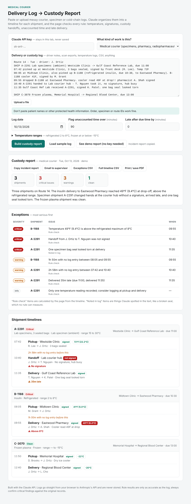

# Chain-of-Custody Log Summarizer

A web tool that turns messy courier, specimen and cold-chain delivery logs into a clear **custody report**: a timeline for every shipment, plus a ranked list of problems such as temperature excursions, unsigned handoffs, breaks in custody, unaccounted time and late deliveries. It uses Claude through the Anthropic API.

**Live demo: [mykel23.github.io/chain-of-custody-summarizer](https://mykel23.github.io/chain-of-custody-summarizer/)** (click "See demo report", no API key needed)

## Why I built this

I work as a medical courier, handling chain of custody for lab specimens, pharmacy deliveries, radiopharmaceuticals and temperature-sensitive materials. Logs come from driver notes, scanner exports and temperature readings, and they're rarely in one clean format. When something goes wrong, someone has to reconstruct who had the item, when, and at what temperature.

Small clinics, labs and food banks often don't have software for this. I built a tool that does the reconstruction in seconds and points out exactly what needs a closer look.

## What it does

- **Reads any log format:** pasted driver notes, CSV or text exports, temperature logs, or a mix. Upload a file or paste it in.
- **Builds a timeline for each shipment:** pickup, handoffs, scans and delivery, with who released and received it, signatures, and temperatures (°F readings are converted to °C).
- **Flags problems, most serious first:**
  - Temperature above or below the allowed range for that type of item
  - Pickups, handoffs or deliveries that weren't signed, or have no signature recorded
  - **Custody breaks**, where someone has the item with no recorded handoff
  - Stretches of time with no log entry
  - Late or missing delivery confirmations
  - Temperature-controlled shipments with no readings
  - Problems only visible in the text, like a torn seal, leak or wrong address
- **Exports for follow-up:** copy an incident report, email it to a supervisor, download exception and full-timeline CSVs, or print to PDF.
- **Adjustable rules:** temperature ranges per category, how much unaccounted time to allow, and a grace period for lateness. Changes rerun the checks instantly.
- **Tailored for the work:** medical courier, lab specimen transport, pharmacy delivery, food bank cold chain, or general logistics.

## How it works

The key design choice is that **Claude reads and the code decides**.

1. **Claude extracts structure.** Logs are messy, so Claude converts the text into structured JSON: shipments, events, times, people, signatures and temperatures. It's told never to invent anything; anything missing comes back empty.
2. **The page runs the compliance rules.** Temperature limits, signature checks, custody tracking, time gaps and lateness are all plain, predictable code. The same timeline always gives the same result, and every finding can be traced back to a specific log entry.
3. **Claude adds only what rules can't measure.** Free-text problems like "seal looked torn" come from Claude and are labeled **"Noted in log"**, so it's always clear which findings were calculated and which were read from the text.

Everything is one HTML file with plain JavaScript, no server or build step, hosted free on GitHub Pages.

## Try it

1. Open the live demo and click **See demo report.** Try changing the refrigerated maximum or the unaccounted-time limit and watch the findings update.
2. To use your own logs, paste a Claude API key (from [platform.claude.com](https://platform.claude.com)), paste or upload a log, and click **Build custody report**.

Your key stays in the browser tab and is never saved. Logs go directly to Anthropic's API and are never stored.

## Default temperature ranges

| Category | Range |
|---|---|
| Refrigerated (insulin, vaccines) | 2 to 8°C |
| Frozen | at or below −15°C |
| Room temperature, controlled substances, ambient specimens | 15 to 30°C |

These are common defaults, not regulatory advice. Every range is editable, so set them to match your own SOPs.

## Privacy

- The page reminds medical users not to paste patient names or other protected health information; IDs work fine.
- Claude is instructed to refer to items by ID only and never repeat patient names.
- Nothing is stored except the user's own settings, in their browser.

## Limits

- Results are only as good as the log. If a handoff was never written down, the tool can only report the gap, not fill it in.
- Times are read as local time, and a time with no date uses the log date you pick.
- Confirm critical findings against the original records before acting on them.

## Ideas for next steps

- Photograph a paper delivery manifest and read it with Claude's vision
- Track a driver's or route's exceptions over weeks to spot recurring problems
- Corrective-action notes on each exception, for audit trails
